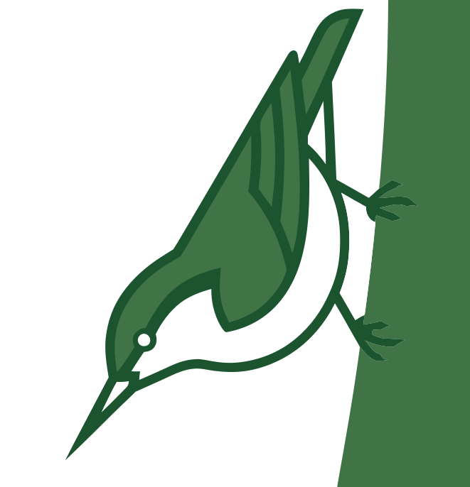

# treemouse



A responsive terminal folder tree browser and Markdown reader built in Go using [Bubble Tea](https://github.com/charmbracelet/bubbletea).

---

## About the Name

The **nuthatch** is a small woodland bird colloquially known as the *"treemouse"* or the *"upside-down bird"*. Unlike most birds that only climb upward, the nuthatch is uniquely capable of walking head-first down tree trunks, methodically inspecting bark crevices, fissures, and seeds.

Much like its avian namesake navigating the bark of forest trees, **treemouse** is designed to nimbly climb up and down directory trees and inspect Markdown files, offering distraction-free, focused reading inside your terminal on both full desktop consoles and narrow mobile SSH screens.

---

## Features

- **Folder Browser & Reader in One:** Seamlessly navigate directories and view Markdown files in a unified terminal interface.
- **Rich Markdown Styling:** Header styling, emphasis, lists, YAML frontmatter support, code formatting, and interactive tables.
- **CJK & Locale-Aware:** Proper width calculation and line wrapping for East Asian characters and punctuation.
- **Outline & Sticky Headings:** Built-in document outline sidebar (`t`) and contextual sticky headers for easy reading of long documents.
- **Search & Interactive Links:** Live in-document search (`/`) and cell/link selection mode (`s`).
- **Mouse & Keyboard Friendly:** Full keyboard shortcuts along with mouse scrolling and click navigation.

---

## Installation

### Prerequisites
- [Go](https://go.dev/) 1.21+

### Build from source
```bash
git clone https://github.com/yookoala/treemouse.git
cd treemouse
go build -o bin/treemouse .
```

---

## Usage

```bash
# Open browser in the current directory
treemouse

# Open browser in a specific directory
treemouse path/to/folder

# Open a specific Markdown file directly in the reader
treemouse path/to/document.md
```

### Key Controls

| Key | Action |
| :--- | :--- |
| `↑` / `↓` / `k` / `j` | Navigate items / scroll text |
| `Enter` | Open selected folder or Markdown file |
| `Esc` | Go back to file browser / close popup or sidebar |
| `:` | Open command palette |
| `/` | Live text search (in reader) |
| `s` | Toggle selection mode for links and tables |
| `t` | Toggle headings / outline sidebar |
| `e` | Open current file in `$EDITOR` |
| `m` | Toggle mouse mode |
| `q` | Quit application |

Mouse scrolling and clicking are also supported.

---

## Development & Contributing

The source code is hosted on GitHub:
- **Repository:** [https://github.com/yookoala/treemouse](https://github.com/yookoala/treemouse)
- **Issues & Bug Reports:** [https://github.com/yookoala/treemouse/issues](https://github.com/yookoala/treemouse/issues)
- **Pull Requests:** [https://github.com/yookoala/treemouse/pulls](https://github.com/yookoala/treemouse/pulls)

Contributions, feature suggestions, and bug reports are welcome!

---

## License

This project is licensed under the MIT License. See [LICENSE.md](LICENSE.md) for details.
